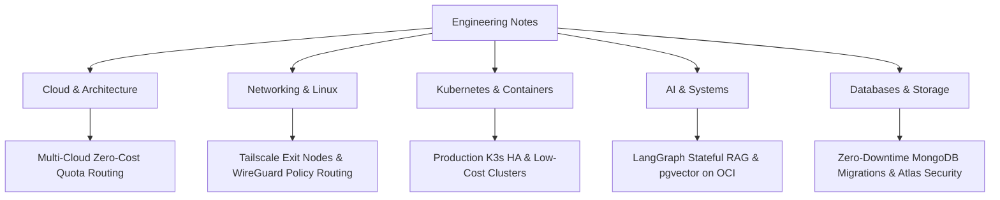

# Engineering Notes & Systems Deep-Dives

Welcome to my personal technical blog and systems engineering notes. Here I document architectural deep-dives, hands-on infrastructure designs, low-level networking explorations, self-hosted services, and production lessons learned across cloud and on-premise environments.

---

## Technical Articles

| Article | Category | Reading Time | Core Technologies |
|---|---|---|---|
| [**Building RootAccess: Zero-Cost Multi-Cloud Serverless CTF**](posts/rootaccess-multi-cloud-ctf-architecture.md) | Cloud & Architecture | 14 min | AWS Lambda, GCP, Cloudflare, OCI, Turso, Redis |
| [**Turning an Old Laptop Into a Permanent Exit Node with Tailscale**](posts/tailscale-permanent-exit-node.md) | Networking & Linux | 15 min | Tailscale, WireGuard, Linux, Policy Routing, QoS |
| [**Building an AI Layer on OpenWA: LangGraph & pgvector on OCI**](posts/openwa-ai-whatsapp-gateway.md) | AI & Systems | 18 min | LangGraph, Workers AI, pgvector, NestJS, OCI |
| [**Production K3s on VPS: 4-Node HA Architecture**](posts/k3s-vps-production-architecture.md) | Kubernetes | 15 min | K3s, WireGuard mesh, HAProxy, Prometheus, CI/CD |
| [**High Availability CTFd on IBM LinuxONE (s390x)**](posts/ctfd-ha-linuxone-s390x.md) | DevOps & Infrastructure | 10 min | s390x, Nginx, PostgreSQL 18, Redis, Docker |
| [**Locking Down MongoDB Atlas: Tailscale App Connectors**](posts/securing-mongodb-atlas-tailscale.md) | DevOps & Security | 10 min | MongoDB Atlas, Tailscale App Connector, K3s |
| [**Moving Data Between MongoDB Clusters Safely**](posts/mongodump-mongorestore-guide.md) | Databases | 12 min | mongodump, mongorestore, oplog sync, Atlas Live Migrate |
| [**Managing K3s from an Android Device**](posts/k3s-android-management.md) | Kubernetes & Mobile | 8 min | K3s, Termux, Headlamp, Tailscale |

---

## Topics Covered

!!! tip "Interactive Code & Diagrams"
    All articles feature full syntax-highlighted code snippets, Mermaid architecture flowcharts, and mathematical formulas rendered natively via MathJax / KaTeX.

---

## About the Author

I am **Uttam Mahata**, a full-stack engineer and systems enthusiast focusing on operating systems, computer networks, DevOps, information security, and distributed computing. 

* 🌐 Portfolio: [uttammahata.in](https://uttammahata.in/)
* 🐙 GitHub: [@Uttam-Mahata](https://github.com/Uttam-Mahata)
* 💼 LinkedIn: [uttam-mahata](https://www.linkedin.com/in/uttam-mahata-4b0364259/)
* 🐦 X / Twitter: [@daemonized_u](https://x.com/daemonized_u)
